<picture>
  <source media="(prefers-color-scheme: dark)" srcset="./images/desk-dark.svg">
  
</picture>

  Engineer, software developer and AI researcher from Natal, Brazil. M.Sc. student in Electrical and Computer Engineering at <a href="https://www.ufrn.br/">UFRN</a>.

  I lead the development team at <a href="https://www.seguroviagem.srv.br/">Real Seguro Viagem</a>.

  At the <a href="https://github.com/model2ai">Model2AI</a> lab (DCA/UFRN) I work in an R&amp;D project with <a href="https://petrobras.com.br">Petrobras</a>.

  
  
  

